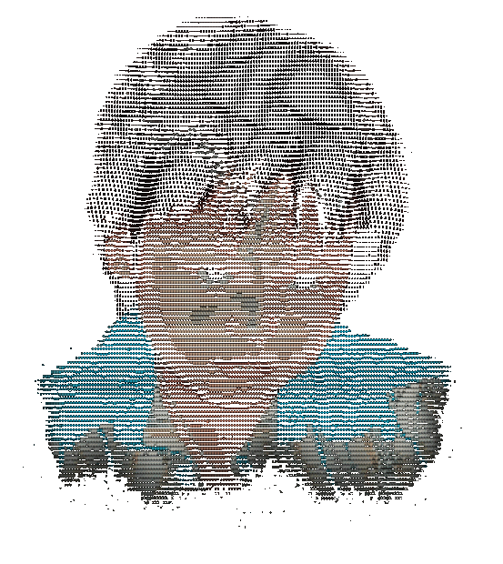

# ASCII_Memory

An interactive ASCII portrait brought to life with subtle motion and mouse interactions.

사진 속 한순간을 살아 움직이는 문자 초상화로 표현한 웹 작품입니다. 사진의 색과 명암을
ASCII 문자로 바꾸고, 눈 깜빡임과 앞머리의 움직임, 마우스에 반응하는 작은 흐트러짐을 더했습니다.

[작품 열기 ↗](https://asciimemory.vercel.app/)



Canvas의 투명 배경을 유지한 반복 GIF입니다. 마우스 반응과 화면 조절은 위 배포 링크에서 확인할 수 있습니다.

## 작품의 움직임

- 문자가 흩어진 위치에서 부드럽게 모이며 인물이 드러납니다.
- 눈꺼풀이 천천히 감겼다가 열리고, 앞머리가 작은 바람에 움직입니다.
- 마우스 주변의 문자만 가볍게 흩어졌다가 원래 위치로 돌아옵니다.
- 먹색 조명과 미세한 배경 질감 위에서 옷 가장자리가 문자 흐름으로 이어집니다.
- 재생·일시정지·다시 보기, 컬러·흑백 전환과 문자 크기 조절을 제공합니다.

## 로컬 실행

Node.js 24.19.0과 npm으로 검증했습니다. WebGL 2를 지원하는 브라우저가 필요합니다.

```sh
git clone https://github.com/ysshxd/ASCII_Memory.git
cd ASCII_Memory
npm ci
npm run dev
```

터미널에 표시되는 로컬 주소를 브라우저에서 엽니다.

```sh
npm run lint     # 정적 검사
npm run build    # TypeScript 검사와 프로덕션 빌드
npm run preview  # 빌드 결과 미리보기
```

## 구현

React · TypeScript · Vite · WebGL 2로 구성했습니다. 문자 모양과 인물 격자는 크기가 바뀔 때
준비하고, 매 프레임에는 시간과 포인터 같은 값만 갱신합니다. GPU 인스턴싱으로 전체 문자를
한 번에 그리며, 열린 눈과 감긴 눈의 질감·문자 모양을 연속적으로 연결합니다.

| 경로 | 역할 |
| --- | --- |
| `src/App.tsx` | 화면과 조작 상태 |
| `src/portrait/PortraitCanvas.tsx` | 문자 데이터 준비와 Canvas 생명주기 |
| `src/portrait/source.ts` | 미리 계산한 문자 데이터 읽기와 화면 크기별 구성 |
| `src/portrait/effects.ts` | 깜빡임 곡선과 포인터 추종 |
| `src/portrait/renderer.ts` | 화면 크기·재생·입력 처리 |
| `src/portrait/glyphRenderer.ts` | 문자 캐시와 GPU 버퍼 |
| `src/portrait/shaders.ts` | 문자·머리카락·눈·호버 렌더링 |

현재 작품은 한 장의 사진에 맞춰 조정되어 있습니다. 임의 사진 업로드 기능은 제공하지 않습니다.
사진 원본과 배경 제거·감긴 눈 PNG는 공개 소스와 배포 산출물에 포함하지 않습니다.
앱은 미리 계산한 문자·색·위치 데이터인 `public/portrait-glyphs.json`만 읽습니다.
최대 256열의 문자 데이터를 화면에 맞게 구성하며, 실행 중 사진을 샘플링하지 않습니다.

이미지 준비에는 AI 편집을 사용했으며, 앱 실행 중에는 외부 사진·AI API를 요청하지 않습니다.
UI에는 Pretendard CDN 폰트를 사용하고, 상단 워드마크와 작품의 문자는 고정폭 글꼴을 유지합니다.
공개된 문자 데이터와 GIF는 화면에 보이는 작품을 담고 있으므로 저장 자체를 막지는 못합니다.

화면 크기에 맞춰 인물 비율을 유지합니다. 시스템의 모션 감소 설정을 존중하며, 터치 입력에는
호버 효과를 적용하지 않습니다. 탭이 숨겨지면 애니메이션을 중단합니다.
